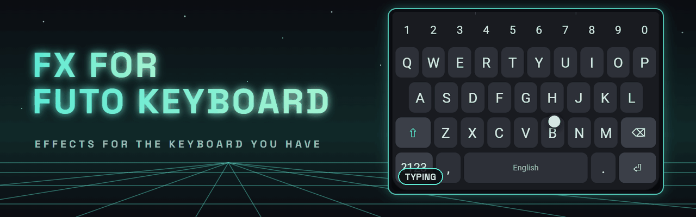
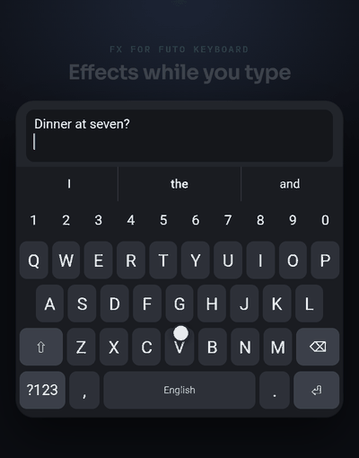
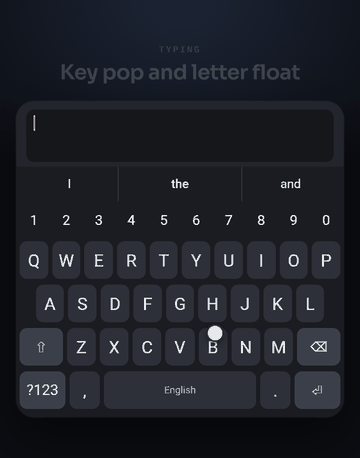
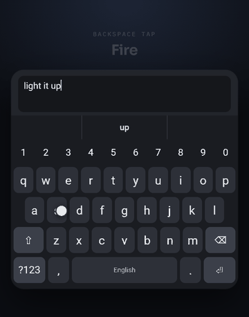
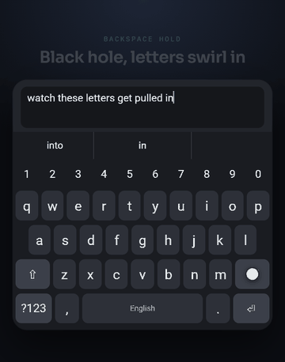
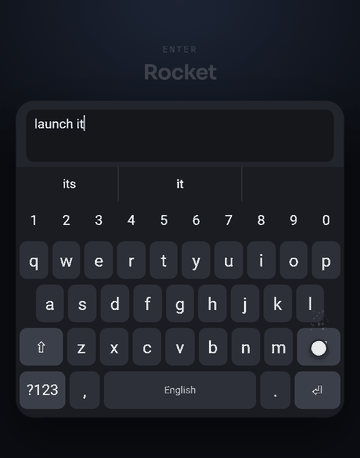
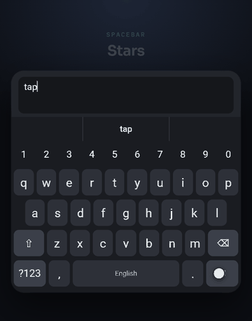
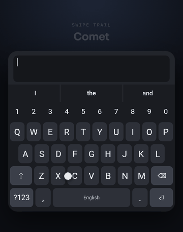
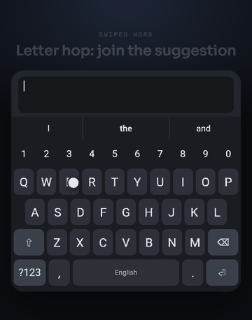

<p align="center">
  
</p>

# FX for FUTO Keyboard

[](https://ko-fi.com/theoerickson)
[](https://github.com/Theo-Erickson/futo-tweaks/releases/latest)
[](LICENSE)

<table>
<tr>
<td width="46%"></td>
<td>

**An unofficial LSPosed / Vector module that adds keyboard effects and typing extras to the official [FUTO Keyboard](https://keyboard.futo.org).** It changes the keyboard at runtime, so you keep using FUTO's own app, with FUTO's updates, and get the effects on top.

The clips are recorded in the [keyfx lab](https://theo-erickson.github.io/keyfx/), the browser version of the module's effects, with the same settings.

</td>
</tr>
</table>

> [!IMPORTANT]
> **Unofficial.** FX for FUTO Keyboard is an independent module by Theo Erickson. It is not made, endorsed or supported by FUTO. Please report problems [here](https://github.com/Theo-Erickson/futo-tweaks/issues), not to FUTO.

## Contents

- [Summary](#summary)
- [Downloads](#downloads)
- [Requirements](#requirements)
- [Install](#install)
- [Features](#features)
- [See it in action](#see-it-in-action)
- [Settings](#settings)
- [Related projects](#related-projects)
- [FAQ](#faq)
- [Troubleshooting](#troubleshooting)
- [Building from source](#building-from-source)
- [How it hooks](#how-it-hooks)
- [Support](#support)
- [License](#license)

## Summary

FUTO Keyboard is an offline, private keyboard. FX for FUTO Keyboard makes it more fun and a bit faster to edit with, without replacing it:

- **Effects while you type:** key pops, floating letters, backspace fire, black holes, swipe trails, letter hop and more, powered by [keyfx](https://github.com/Theo-Erickson/keyfx).
- **Vertical spacebar cursor:** drag the spacebar up or down to move between lines.
- **Hold backspace for whole words** at a pace you choose.
- **Hide the keyboard navigation bar** on Android 15 and newer.

Every feature has its own switch, and changes apply right away, even while the keyboard is open. FX for FUTO Keyboard contains no FUTO code. It hooks the app you already have installed.

Don't have root? [FXboard](https://github.com/Theo-Erickson/fxboard) is a standalone keyboard with the same extras built in.

## Downloads

| | |
|---|---|
| **Latest APK** | [Releases page](https://github.com/Theo-Erickson/futo-tweaks/releases/latest), file `fx-for-futo-r<N>.apk` |
| **All versions** | [All releases](https://github.com/Theo-Erickson/futo-tweaks/releases) |
| **Effects lab** | [Open the lab](https://theo-erickson.github.io/keyfx/) in a browser to design settings, then import them |
| **Source** | [Download ZIP](https://github.com/Theo-Erickson/futo-tweaks/archive/refs/heads/main.zip) or `git clone https://github.com/Theo-Erickson/futo-tweaks.git` |

Official builds only come from this repository's Releases. Each release is built by GitHub Actions from the commit it names. Check the signing key before installing an APK from anywhere else:

```
SHA-256: D6:26:CA:25:99:B1:13:EA:7E:11:6B:D4:E3:3F:F9:CA:89:5C:B7:88:2A:EF:42:1C:2D:B0:BB:FF:D2:92:B5:2C
```

## Requirements

- **Android 11** or newer.
- **Root** with **[LSPosed](https://github.com/LSPosed/LSPosed)** or **Vector** installed and working.
- **[FUTO Keyboard](https://keyboard.futo.org)** installed, from FUTO's site or Google Play.
- Hiding the navigation bar needs **Android 15** or newer. Everything else works from Android 11.

## Install

1. Download `fx-for-futo-r<N>.apk` from the [latest release](https://github.com/Theo-Erickson/futo-tweaks/releases/latest) and install it.
2. Open LSPosed or Vector, go to **Modules**, and enable **FX for FUTO Keyboard**.
3. In the module's scope, tick **FUTO Keyboard** (whichever variant you have installed).
4. Force stop FUTO Keyboard in Android's **Settings > Apps**, then open any text box to bring the keyboard back.
5. Open FX for FUTO Keyboard from your app drawer (or from the module list) and switch on the effects you want.

**Updating:** install the new APK over the old one, then force stop FUTO Keyboard again. Your settings are kept.

## Features

### Typing extras

- **Vertical spacebar cursor:** drag the spacebar up or down to move the cursor between lines. Once a drag goes mostly vertical, the module takes it over and moves by line vertically and by character sideways. Short or sideways drags stay with FUTO, so its normal cursor drag, language swipe and long press keep working.
- **Hold backspace for whole words:** after a few single letters (adjustable), a held backspace deletes a word at a time, at a pace you set. It deletes through FUTO's own backspace, so FUTO's word tracking stays correct. Its settings are in the **Backspace hold** card.
- **Hide the keyboard navigation bar:** removes the down arrow and keyboard switcher below the keys (Android 15 or newer).

### Effects

All effects come from [keyfx](https://github.com/Theo-Erickson/keyfx) and its lab, each with its own settings:

| Group | Effects |
|---|---|
| Typing | Key pop, letter float (rise or ghost key), heat streak (glow, wave, progress bar, energizing circuit or rising embers, with an optional combo counter), neighbor wave (wave, orbit, firework or firecracker), ripple, sparks, water drop |
| Special keys | Enter: sweep, shockwave, rocket, row wave or check mark. Spacebar: stars, puff or shimmer. Backspace tap: fire, slash, shatter, laser, disintegrate, rewind, glitch, shredder, swirl in or vacuum on curves, with the deleted letters reacting too |
| Backspace hold | The key becomes a black hole, lava, an opening box, a hole or a portal, and the deleted letters swirl in, fly on curves, ride a tractor beam, or get one press each |
| Swipe trail | Key trace, comet, ink brush, circuit trail, lightning, neon tube, arrow trail, water wake, stardust |
| Swipe word | Letter hop on the number row (or the top row without one), constellation, commit burst, with letter picking by turns, pauses or every key crossed |
| Long press and spacebar | Hold charge (liquid fill, ring, orbiting sparks, burning fuse or clock wipe) and the spacebar trackpad (line rails, dot field, still grid, sonar or spotlight) |
| Keyboard show | Center bloom or row cascade |

When one press removes a whole word (like undoing a swiped word), every letter gets the backspace effect. Effects use your Material You accent by default, and switch off when Android's "Remove animations" setting is on.

## See it in action

Recorded in the [keyfx lab](https://theo-erickson.github.io/keyfx/), the browser version of the module's effects, with the same settings; the lab's keyboard is a mock of FUTO Keyboard. Each clip runs through a few of the effects in its group. The module draws over FUTO's keys without moving them, so these clips leave out what only [FXboard](https://github.com/Theo-Erickson/fxboard) can do, like scaling the real key.

<table>
<tr>
<td align="center"><br><b>Typing</b>: key pop, letter float, heat streak, neighbor wave, sparks</td>
<td align="center"><br><b>Backspace tap</b>: fire, shatter, laser, disintegrate, glitch</td>
</tr>
<tr>
<td align="center"><br><b>Backspace hold</b>: black hole, portal, lava rumble</td>
<td align="center"><br><b>Enter</b>: rocket, shockwave, check mark, row wave</td>
</tr>
<tr>
<td align="center"><br><b>Spacebar</b>: stars, puff and shimmer, then drag it as a trackpad</td>
<td align="center"><br><b>Swipe trail</b>: comet, lightning, neon tube, ink brush, circuit</td>
</tr>
<tr>
<td align="center"><br><b>Swiped word</b>: letter hop three ways, and constellation</td>
</tr>
</table>

## Settings

<!-- Media: a screenshot of the settings screen, e.g.  -->

Open the module's settings from LSPosed or Vector, or from the FX for FUTO Keyboard app icon.

- **Changes apply right away**, even while the keyboard is open.
- **Test field:** the box at the top stays in view, so you can type and swipe in it while you adjust settings.
- **Preview:** each effect card has a Preview button that turns every other effect off for a moment and opens a text field, so you see that effect alone. Closing it, or leaving the screen, turns your effects back on as they were.
- **Import:** paste an export from the lab to copy its settings over. Section and setting names match the lab's, and anything the module doesn't have is skipped.

A few lab settings need changes inside FUTO itself: scaling and shaking the real keys, fading their labels, the key-by-key show animation, lighting up the predicted word, the bloom accent popup, the hide animation, and the show styles that move the real keys (piano, decode and flap). A module can't make those safely, so they come with [FXboard](https://github.com/Theo-Erickson/fxboard). The settings screen lists them at the bottom, under **Needs FXboard**.

## Related projects

| Project | What it is | Pick it if... |
|---|---|---|
| **FX for FUTO Keyboard** (this repo) | An LSPosed / Vector module for the official FUTO Keyboard | you have root and want to keep FUTO's official app and updates |
| [FXboard](https://github.com/Theo-Erickson/fxboard) | An FX keyboard: a fork of FUTO Keyboard with the extras built in | you don't have root, or want the effects a module can't add |
| [keyfx](https://github.com/Theo-Erickson/keyfx) | The effects library both apps use, and the lab | you build keyboards, or want to design effect settings in a browser |
| [FUTO Keyboard](https://keyboard.futo.org) (official) | The keyboard this module modifies. Not affiliated with this project | you want the keyboard as FUTO ships it |

## FAQ

**Is this an official FUTO project?**
No. FX for FUTO Keyboard is an independent, unofficial module by Theo Erickson. It is not made, endorsed or supported by FUTO. Please don't send FUTO bug reports about it.

**Does it change or replace my FUTO Keyboard?**
No. The FUTO Keyboard app on your phone stays exactly as installed. The module only changes how it behaves while it runs, and disabling the module in LSPosed (then force stopping FUTO) puts everything back.

**Does it break when FUTO updates?**
Usually not. It hooks only names that stay stable across FUTO updates (see [How it hooks](#how-it-hooks)), and each hook installs on its own. If an update breaks one, only that feature stops working and the rest keep going. Please [open an issue](https://github.com/Theo-Erickson/futo-tweaks/issues) with your FUTO version.

**Does it read what I type?**
It sees the same key events the keyboard does, because it draws effects for them, but it stores nothing and has no internet permission. You can read every hook in [`app/`](app).

**Do I need root?**
Yes, LSPosed and Vector need root. Without root, try [FXboard](https://github.com/Theo-Erickson/fxboard).

**Will the effects drain my battery or slow down typing?**
Effects only draw while they are animating, and each one can be switched off or toned down. They all switch off with Android's "Remove animations" setting.

**Why is a setting from the lab missing?**
Some effects need changes inside FUTO's code, which a module can't make. Those are in FXboard.

**How do I support the project?**
Through [Ko-fi](https://ko-fi.com/theoerickson). It's optional, and every feature is free.

## Troubleshooting

| Problem | Try this |
|---|---|
| Nothing changes after install | Check the module is enabled **and** FUTO Keyboard is ticked in its scope, then force stop FUTO Keyboard. |
| Some features work and others don't | A FUTO update may have moved something. Open the LSPosed log, look for `FX for FUTO Keyboard` lines, and include them in an issue. |
| No effects at all | Check Android's **Settings > Accessibility > Remove animations** is off. |
| The navigation bar is still there | That option needs Android 15 or newer. |

## Building from source

- **Android Studio:** open this folder and run *Build > Build APK(s)*.
- **Command line:** `./gradlew assembleRelease` (output in `app/build/outputs/apk/release/`). Needs JDK 17.
- **Without the Android SDK:** `nosdk/build.sh` builds with javac, dx, aapt2 and uber-apk-signer, all from GitHub. See the script's header for the jars it needs.
- **GitHub Actions:** push to a fork, and `.github/workflows/build.yml` builds the APK on every pull request and publishes a release on every push to `main`. Add the `FORK_KEYSTORE_B64`, `FORK_KEYSTORE_PASSWORD`, `FORK_KEY_ALIAS` and `FORK_KEY_PASSWORD` secrets to sign with your own key; without them it signs with a throwaway debug key.

### Recording the README media

The GIFs above are recorded with Readmotion from `tools/readmotion/`, playing keyfx's lab in its showcase mode from the `keyfx/` subtree. The effect gallery is shared with keyfx and FXboard (`keyfx/tools/readmotion/showcase.py`); `scenes.py` adds this module's hero. To record them again:

```
python tools/readmotion/scenes.py
readmotion-cli capture tools/readmotion/readmotion.json
readmotion-cli build tools/readmotion/readmotion.json
```

`scenes.py` writes the recordings into the config, so edit it rather than the steps in the JSON. `build` also writes full-size MP4s of every clip to `tools/readmotion/.work/full/`.

The hero is meant to end on a phone recording of the module's settings in the real FUTO Keyboard, which the lab can't show. That recording is still to do: [`tools/readmotion/phone/TODO.md`](tools/readmotion/phone/TODO.md) says what to record and how to add it.

### Project layout

| Folder | What's in it |
|---|---|
| `app/` | The Xposed module: it hooks FUTO, turns FUTO's events into keyfx events, and generates its settings screen from the keyfx schema |
| `keyfx/` | The [keyfx](https://github.com/Theo-Erickson/keyfx) effects library, pulled in with `git subtree`. Fix effects upstream in keyfx, not here |
| `nosdk/` | The build script for machines without the Android SDK |

## How it hooks

Nav bar hiding and the cursor position use only Android's `InputMethodService`. Touches come from `MainKeyboardView.onTouchEvent`, typed keys and swipes from `LatinIMELegacy`'s `KeyboardActionListener` methods, and key positions from the `Keyboard` and `Key` fields. FUTO builds without name obfuscation, and these are all things R8 can't inline away, so they stay stable across updates. Each hook installs independently and logs to the LSPosed log if a FUTO update breaks it, without affecting the others.

## Support

FX for FUTO Keyboard is free, with no ads and nothing locked. If you enjoy it, you can support the work on [Ko-fi](https://ko-fi.com/theoerickson). The same page supports keyfx.

## License

FX for FUTO Keyboard is licensed under the [Apache License 2.0](LICENSE). See [NOTICE](NOTICE). The `keyfx/` folder is also Apache-2.0 and keeps its own NOTICE. FX for FUTO Keyboard contains no FUTO code.

FUTO and FUTO Keyboard are trademarks of FUTO Holdings, Inc. This project uses those names only to say which app the module works with and changes. It claims no rights to them, and is not affiliated with, endorsed by or sponsored by FUTO.
